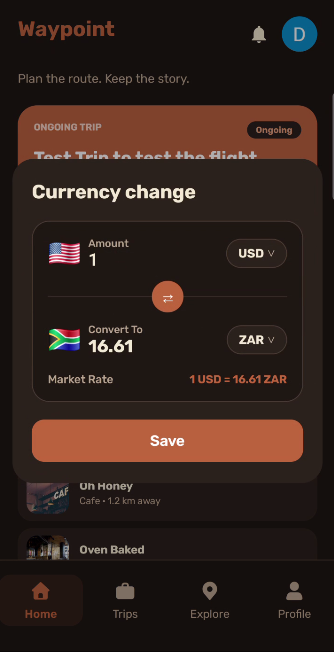

# Waypoint

> A travel itinerary planner for Android built with Kotlin, Jetpack Compose, and real-time API data.

[](https://github.com/JoshRobertsZA/PROG7314/actions/workflows/android-ci.yml)

[](https://github.com/JoshRobertsZA)
[](https://github.com/ST10438409-Emeris)
[](https://github.com/GraceBerrill)
[](https://github.com/ST10356369)

### Submission Links

[](https://prog7314-git-287180570190.africa-south1.run.app/docs) &nbsp; [](https://youtu.be/kx_R5qv70TE)

The Swagger page is public and needs no setup - it documents all 25 endpoints and can
call them live. `GET /health` and `GET /counter/{key}` work straight away; every other
endpoint requires a Firebase ID token and returns `401` without one. The raw
specification is at
[openapi.json](https://prog7314-git-287180570190.africa-south1.run.app/openapi.json).

---

## Contents

- [About](#about)
- [Release Notes](#release-notes)
- [Features](#features)
- [Architecture](#architecture)
- [APIs Used](#apis-used)
- [Cloud Sync Architecture](#cloud-sync-architecture)
- [CI/CD and Deployment](#cicd-and-deployment)
  - [Android CI - GitHub Actions](#android-ci---github-actions)
  - [REST API - Google Cloud Run](#rest-api---google-cloud-run)
- [Cloud Data Verification](#cloud-data-verification)
- [Screenshots](#screenshots)
- [Play Store Preparation](#play-store-preparation)
- [Demo Video](#demo-video)
- [Running the Project Locally](#running-the-project-locally)
- [AI Usage](#ai-usage)
- [References](#references)

---

## About

Waypoint lets travellers plan and manage trips from a single app. Users can build day-by-day itineraries, track live flight status, check local weather and currency rates, discover nearby places, and receive push notifications before departure. Trip data is synced to the cloud via a dedicated REST API backed by Firestore, and is also stored locally in a SQLite database so the app works offline.

---

## Release Notes

See [RELEASE_NOTES.md](RELEASE_NOTES.md) for everything added since the Part 2 prototype, including the sync, push, guardian and dark-theme work below, grouped by area.

---

## Features

- **Google and email sign-in**: Plus biometric lock (with device-credential fallback) for returning sessions
- **Trip management**: Create, edit, and delete trips with date ranges and destinations
- **Day-by-day itinerary builder**: Flight tracking (AirLabs) per leg, date-aware so the right day's status is shown
- **Explore nearby**: Points of interest powered by LocationIQ, with a per-user local cache
- **Live weather**: Displayed for any destination via OpenWeatherMap
- **Currency converter**: Any base/target pair, using real-time rates from ExchangeRate-API
- **Wikipedia summaries**: Used for destinations and places
- **Push notifications**: Server-sent via Firebase Cloud Messaging on trip creation, with WorkManager-scheduled reminders
- **Cloud sync**: Offline-first with local SQLite as source of truth and an outbox queue for pending changes; trips and itinerary sync to the cloud via REST API and are pulled back on login to restore data on new or wiped devices
- **API usage guardian**: Tracks daily/monthly third-party API usage and falls back to cached data before a free-tier limit is hit
- **Profile management**: Edit display name, delete account (cascades through cloud data and re-authenticates first)
- **Dark theme**: Follows the system setting
- **Multi-language support**: English (default), isiZulu, isiXhosa, with an automated test enforcing translation parity
- **GitHub Actions CI**: Automated lint, unit tests, API tests, and APK build on every push; signed release bundles published automatically on `main`

---

## Architecture

| Layer | Technology |
|---|---|
| Language | Kotlin |
| UI | Jetpack Compose |
| Pattern | MVVM (ViewModel + StateFlow) |
| Local database | SQLite via `SQLiteOpenHelper` |
| Cloud sync | Custom REST API (Node.js) hosted on Google Cloud Run |
| Cloud database | Firebase Firestore (via REST API, not directly from app) |
| Authentication | Firebase Auth (Google SSO) + BiometricPrompt |
| Push notifications | Firebase Cloud Messaging + WorkManager |
| HTTP client | OkHttp |
| Async | Kotlin Coroutines |
| Build | Gradle (Kotlin DSL) |

Third-party API keys are fetched at runtime from the Waypoint REST API (`GET /config/keys`, authenticated with a Firebase ID token) via `core/secrets/RemoteSecrets.kt`, and cached locally so the app still works offline after the first successful fetch. The Firebase web client ID — not itself a secret — is served separately and unauthenticated from `GET /config/web-client-id`, since it's needed before a user has signed in to start Google Sign-In. See [`api/.env.example`](api/.env.example) for where the server-side values live.

---

## APIs Used

| API | Purpose |
|---|---|
| [AirLabs](https://airlabs.co/) | Real-time flight status and schedule lookup by flight number |
| [OpenWeatherMap](https://openweathermap.org/api) | Current weather and forecasts for trip destinations |
| [ExchangeRate-API](https://www.exchangerate-api.com/) | Live currency exchange rates for the in-app converter |
| [LocationIQ](https://locationiq.com/) | Reverse geocoding and nearby points-of-interest search |
| [Wikipedia REST API](https://en.wikipedia.org/api/rest_v1/) | City and place summaries displayed on destination cards |
| [CounterAPI](https://counterapi.dev/) | Anonymous usage counter for place search events |
| [Firebase Cloud Messaging](https://firebase.google.com/docs/cloud-messaging) | Push notifications for trip reminders |
| [Waypoint REST API](https://prog7314-git-287180570190.africa-south1.run.app) | Custom Cloud Run API for trip CRUD, cloud sync, secure remote fetch of API keys, and the shared weather/currency/places cache |

---

## Cloud Sync Architecture

The app follows an offline-first pattern:

1. Every trip and itinerary write (create, update, delete) hits SQLite immediately so the UI never waits on the network
2. The write is also enqueued in a local `sync_outbox` table; repeated edits to the same record are coalesced into one pending operation instead of replaying every intermediate state
3. A `SyncWorker`, constrained to run only with network access, drains the outbox in the background and retries failed entries with backoff — including on `401`, `408` and `429` responses, instead of dropping them
4. On login, reconnect, and pull-to-refresh, the app pulls cloud trips and itinerary and merges them into SQLite with last-write-wins, so local edits are never silently overwritten
5. The REST API authenticates every request using the user's Firebase ID token

This means the app works fully offline, queued changes are never lost, and data is restored automatically when signing in on a new or wiped device.

---

## CI/CD and Deployment

Two pipelines: automated continuous integration for the Android app, and container
deployment for the REST API.

### Android CI - GitHub Actions

Every push and pull request to `main` or `dev` triggers four parallel jobs on
`ubuntu-latest` with JDK 17 and a cached Gradle setup, plus an unsigned release assemble
job that catches R8/minification problems before a real signed build:

1. **Lint** - runs `./gradlew lintDebug` and uploads the HTML report as an artifact
2. **Unit Tests** - runs `./gradlew testDebugUnitTest`, uploads the XML results, and
   publishes a pass/fail summary as a PR check
3. **Build** - runs `./gradlew assembleDebug` and uploads the debug APK as an artifact
4. **API Tests** - runs `npm test` (Jest + Supertest) in [`api/`](api)

A `concurrency` group cancels superseded runs so only the newest commit on a branch is
tested. A Discord webhook posts a per-job status update and a final summary, so the team
is notified without checking GitHub. The workflow can also be triggered manually via
`workflow_dispatch`. A separate [`release.yml`](.github/workflows/release.yml) workflow
builds a signed release bundle and publishes a GitHub Release on every push to `main` -
see [Play Store Preparation](#play-store-preparation).

CI configuration: [`.github/workflows/android-ci.yml`](.github/workflows/android-ci.yml)

**Unit tests:** 194 JUnit tests across 22 files covering local persistence models, cache
staleness and serialisation, validation rules, biometric error mapping, sync failure
handling, and other pure business logic. Run locally with `./gradlew testDebugUnitTest`;
results land in `app/build/reports/tests/testDebugUnitTest/`, the same report CI uploads
as the `unit-test-report` artifact.

**API tests:** 52 Jest + Supertest tests across 7 files covering auth middleware, trips,
itinerary, account deletion, counters and push, using an in-memory Firestore mock so no
real credentials are needed. Run locally with `npm test` from [`api/`](api).

<details>
<summary>Test class breakdown</summary>

| Test class | What it covers |
|---|---|
| [`TripEntityTest`](app/src/test/java/com/waypoint/app/TripEntityTest.kt) | Trip entity creation, chronological date sorting, nullable destination handling |
| [`TripValidationTest`](app/src/test/java/com/waypoint/app/TripValidationTest.kt) | Trip name length, date order, and flight number normalisation/format rules |
| [`TripMergeTest`](app/src/test/java/com/waypoint/app/TripMergeTest.kt) | Last-write-wins merge of cloud trips pulled during sync |
| [`ItineraryEntitiesTest`](app/src/test/java/com/waypoint/app/ItineraryEntitiesTest.kt) | Itinerary day, flight, lodging/car rental, and place entity initialization |
| [`OutboxCoalescingTest`](app/src/test/java/com/waypoint/app/OutboxCoalescingTest.kt) | Sync outbox coalescing rules and parent-before-child ordering |
| [`SyncFailureRulesTest`](app/src/test/java/com/waypoint/app/SyncFailureRulesTest.kt) | Which sync failures are retried (401/408/429) vs dropped |
| [`CacheModelsTest`](app/src/test/java/com/waypoint/app/CacheModelsTest.kt) | Weather, currency, and places cache staleness thresholds |
| [`PlacesCacheOrderTest`](app/src/test/java/com/waypoint/app/PlacesCacheOrderTest.kt) | Local-first cache read order with shared-cache fallback |
| [`PlacesCacheSerializerTest`](app/src/test/java/com/waypoint/app/PlacesCacheSerializerTest.kt) | Places cache JSON round-trip and malformed-input handling |
| [`GitHubCacheRepositoryPathTest`](app/src/test/java/com/waypoint/app/GitHubCacheRepositoryPathTest.kt) | Shared cache key construction for weather and currency |
| [`WeatherRepositoryTest`](app/src/test/java/com/waypoint/app/WeatherRepositoryTest.kt) | City-name-to-slug conversion for weather lookups |
| [`CurrencyConversionTest`](app/src/test/java/com/waypoint/app/CurrencyConversionTest.kt) | Conversion and rounding across any currency pair |
| [`AirLabsDateTest`](app/src/test/java/com/waypoint/app/AirLabsDateTest.kt) | Date-scoped flight schedule lookup and cache keys |
| [`ExplorePlaceFilterTest`](app/src/test/java/com/waypoint/app/ExplorePlaceFilterTest.kt) | Category filtering (restaurants, parks, all) on Explore results |
| [`EmailAuthValidatorTest`](app/src/test/java/com/waypoint/app/EmailAuthValidatorTest.kt) | Email/password sign-up and sign-in validation rules |
| [`ProfileTest`](app/src/test/java/com/waypoint/app/ProfileTest.kt) | Display name validation and account-deletion reauthentication rules |
| [`BiometricErrorsTest`](app/src/test/java/com/waypoint/app/BiometricErrorsTest.kt) | Biometric error-code to user-facing message mapping |
| [`UsageGuardianTest`](app/src/test/java/com/waypoint/app/UsageGuardianTest.kt) | API usage thresholds and cache-fallback decisions |
| [`AmountInputTest`](app/src/test/java/com/waypoint/app/AmountInputTest.kt) | Currency amount input parsing, including comma decimals |
| [`AppLanguageTest`](app/src/test/java/com/waypoint/app/AppLanguageTest.kt) | Supported locale tags and display names |
| [`TranslationParityTest`](app/src/test/java/com/waypoint/app/TranslationParityTest.kt) | Fails if an isiZulu or isiXhosa string key is missing or stale |
| [`ExampleUnitTest`](app/src/test/java/com/waypoint/app/ExampleUnitTest.kt) | Default Android Studio template test |

</details>

### REST API - Google Cloud Run

The API in [`api/`](api/) is containerised and deployed to Cloud Run:

```bash
gcloud run deploy prog7314-git --source api --region africa-south1
```

This builds the [`api/Dockerfile`](api/Dockerfile) (a slim Node 20 image installing
production dependencies only), pushes the image to Artifact Registry tagged with the
current Git commit SHA, and rolls out a new revision.

| Setting | Value |
|---|---|
| Service | `prog7314-git` |
| Region | `africa-south1` (Johannesburg, lowest latency for South African users) |
| Resources | 1 vCPU, 512 MiB |
| Scaling | 0 to 20 instances - scales to zero when idle |
| Credentials | Secret Manager secret `firebase-secret`, injected at runtime as `FIREBASE_SERVICE_ACCOUNT` |
| Ingress | Public, with authorisation enforced per-request by Firebase ID token |

Two properties worth noting. The Firestore service account key is never in the
repository or the container image - Cloud Run injects it from Secret Manager at runtime,
so it can be rotated without a code change. And because each image is tagged with the
commit it was built from, every running revision traces back to an exact point in the
source history; Cloud Run retains previous revisions, so a bad deploy is rolled back by
shifting traffic rather than rebuilding.

API deployment is run manually rather than from GitHub Actions, which keeps a deliberate
gate between merging code and changing the live service the app depends on.

---

## Cloud Data Verification

The demonstration video covers the app and the REST API layer. This section covers the
other end of the pipeline: the hosted authentication service and the Firestore database,
showing that data written in the app is captured and modified in the cloud.

### Firebase Authentication

Users signing in with Google SSO appear in the Firebase Authentication user table. Each
user's UID is the `accountId` written onto every trip, which is how the API scopes data
to its owner.


### Firestore - trips collection

Trips created in the app are written to Firestore through the REST API. The `accountId`
field matches the signed-in user's Firebase UID, and no document can be read or written
by another account.


### Firestore - itinerary collections

The API also exposes itinerary endpoints backed by their own collections, linked by
`tripId` and `dayId`: `itinerary_days`, `itinerary_flights`, `itinerary_lodging`,
`itinerary_cars` and `itinerary_places`. Each enforces the same ownership check by
resolving the parent trip's `accountId` before any read or write.

These records are written through the REST API. In the current build the Android app
syncs trips to the cloud and keeps itinerary detail in local SQLite, so the collections
below were populated by calling the documented endpoints directly.


---

## Screenshots

| Welcome | Home | Itinerary | Explore |
|---|---|---|---|
|  |  |  |  |

*(Screenshots captured on a physical Android device)*

### Feature screens

| Flight status | Currency converter |
|---|---|
|  |  |

### Dark mode

The app follows the phone's dark mode setting.

| Home (currency converter) | Itinerary (flight status) | Profile |
|---|---|---|
|  |  |  |

---

## Play Store Preparation

The release build is minified with R8, signed with a private upload keystore (kept out of git, see `keystore.properties.example`) and versioned `1.0.0`. Store text, the privacy policy and the Data safety answers are in [`docs/store`](docs/store). The privacy policy is also published at <https://st10438409-emeris.github.io/waypoint-privacy/>.

| Signing key | Release variant | Build successful | Signed APK file |
|---|---|---|---|
|  |  |  |  |

### Release pipeline

Every push to `main` runs [`release.yml`](.github/workflows/release.yml). It reads `versionName` from `app/build.gradle.kts`, builds a signed release bundle with `./gradlew bundleRelease` (R8 minification on), uploads it as a workflow artifact, and creates a GitHub Release tagged `v<versionName>` with the `.aab` and the R8 mapping file attached. If the tag already exists, no new release is made, so bump `versionName` to publish the next one. The first release is `v1.0.0`. The workflow can also be started by hand from the Actions tab.

CI signs with a throwaway demo key kept in [`ci/`](ci/README.md), so the pipeline needs no secrets. It is not the Play upload key, which stays on the maintainer's machine and is never committed.

The signed Android App Bundle build is documented in [`assets/release`](assets/release) (images 01 to 04). Store graphics are in [`assets/store`](assets/store).

---

## Demo Video

[Watch on YouTube](https://youtu.be/kx_R5qv70TE)

The video walks through: signing in, creating a trip, adding itinerary days and flights, exploring nearby places, checking weather and currency, and receiving a push notification.

---

## Running the Project Locally

1. Clone the repo
   ```
   git clone <<URL>>
   ```
2. Add your `google-services.json` from the Firebase console into `app/`
3. Open the project in Android Studio Hedgehog or later
4. Run on a physical device (API 26+) or an emulator

> Third-party API keys and the Firebase web client ID are fetched at runtime from the Waypoint REST API and cached locally — no local key file is required. See `apikey.properties.example` if you want to override a key with your own personal quota instead of the shared team cache.

---
## AI Usage

See [docs/ai-writeup.md](docs/ai-writeup.md) for which AI tools were used, what for,
and how their output was checked before being committed.

---

## References

AirLabs (n.d.) *AirLabs Flight API documentation*. Available at: https://airlabs.co/docs (Accessed: 19 September 2026).

Android Developers (2024) *Guide to app architecture*. Available at: https://developer.android.com/topic/architecture (Accessed: 1 September 2026).

Android Developers (2024) *Jetpack Compose documentation*. Available at: https://developer.android.com/jetpack/compose/documentation (Accessed: 2 September 2026).

Android Developers (2024) *SQLiteOpenHelper*. Available at: https://developer.android.com/reference/android/database/sqlite/SQLiteOpenHelper (Accessed: 16 September 2026).

Android Developers (2024) *Schedule tasks with WorkManager*. Available at: https://developer.android.com/topic/libraries/architecture/workmanager (Accessed: 18 September 2026).

Android Developers (2024) *Show a biometric authentication dialog*. Available at: https://developer.android.com/training/sign-in/biometric-auth (Accessed: 18 September 2026).

Android Developers (2024) *Sign in your user with Credential Manager*. Available at: https://developer.android.com/identity/sign-in/credential-manager (Accessed: 18 September 2026).

CounterAPI (n.d.) *CounterAPI documentation*. Available at: https://counterapi.dev/ (Accessed: 17 September 2026).

ExchangeRate-API (n.d.) *ExchangeRate-API documentation*. Available at: https://www.exchangerate-api.com/docs (Accessed: 9 September 2026).

GeeksforGeeks (2023) *Google authentication with Firebase*. Available at: https://www.geeksforgeeks.org/firebase/google-authentication-with-firebase/ (Accessed: 3 September 2026).

GitHub (2024) *REST API endpoints for repository contents*. Available at: https://docs.github.com/en/rest/repos/contents (Accessed: 17 September 2026).

GitHub (2024) *GitHub Actions documentation*. Available at: https://docs.github.com/en/actions (Accessed: 18 September 2026).

Google (2024) *Firebase Authentication for Android*. Available at: https://firebase.google.com/docs/auth/android/start (Accessed: 4 September 2026).

Google (2023) *Build an Android app with Firebase and Jetpack Compose* (codelab). Available at: https://firebase.google.com/codelabs/build-android-app-with-firebase-compose (Accessed: 5 September 2026).

Google (2024) *Get started with Cloud Firestore on Android*. Available at: https://firebase.google.com/docs/firestore/quickstart (Accessed: 17 September 2026).

Google (2024) *Cloud Firestore security rules*. Available at: https://firebase.google.com/docs/firestore/security/get-started (Accessed: 19 September 2026).

Google (2024) *Cloud Firestore REST API*. Available at: https://firebase.google.com/docs/firestore/use-rest-api (Accessed: 19 September 2026).

Google (2024) *Firebase Cloud Messaging documentation*. Available at: https://firebase.google.com/docs/cloud-messaging (Accessed: 18 September 2026).

Google Cloud (2024) *Cloud Run documentation*. Available at: https://cloud.google.com/run/docs (Accessed: 19 September 2026).

JUnit Team (2024) *JUnit 4*. Available at: https://junit.org/junit4/ (Accessed: 18 September 2026).

Kotlin (2024) *Coroutines overview*. Available at: https://kotlinlang.org/docs/coroutines-overview.html (Accessed: 17 September 2026).

LocationIQ (n.d.) *LocationIQ API documentation*. Available at: https://locationiq.com/docs (Accessed: 17 September 2026).

Muturia, E. (2023) *Firebase in Jetpack Compose: authentication & adding data to Cloud Firestore*. Medium. Available at: https://medium.com/@emmanuelmuturia/firebase-in-jetpack-compose-authentication-adding-data-to-cloud-firestore-a6a8e5ebee19 (Accessed: 6 September 2026).

OpenWeatherMap (n.d.) *OpenWeatherMap API documentation*. Available at: https://openweathermap.org/api (Accessed: 16 September 2026).

RapidDevelopers (n.d.) *How to use Firebase Auth with Google login*. Available at: https://www.rapidevelopers.com/firebase-tutorial/how-to-use-firebase-auth-with-google-login (Accessed: 7 September 2026).

Square (2024) *OkHttp documentation*. Available at: https://square.github.io/okhttp/ (Accessed: 17 September 2026).

Stackademic (2024) *Sign in with Google: Firebase Auth + Credential Manager in Jetpack Compose*. Available at: https://blog.stackademic.com/sign-in-with-google-firebase-auth-credential-manager-jetpack-compose-6e151a8c6825 (Accessed: 18 September 2026).

Swagger (2024) *OpenAPI Specification*. Available at: https://swagger.io/specification/ (Accessed: 20 September 2026).

Wikimedia Foundation (n.d.) *Wikipedia REST API*. Available at: https://en.wikipedia.org/api/rest_v1/ (Accessed: 17 September 2026).

YouTube (n.d.) *Video tutorial: Firebase Google Sign-In implementation in Android*. Available at: https://www.youtube.com/watch?v=u6lUQ2PmvgE (Accessed: 27 July 2026).

---

IIE Emeris - Cape Town | PROG7314 | 2026
