# Waypoint

> A travel itinerary planner for Android, built with Kotlin and Jetpack Compose, backed by a custom REST API on Google Cloud Run and Firestore.

[](https://github.com/JoshRobertsZA/PROG7314/actions/workflows/android-ci.yml)
[](https://github.com/JoshRobertsZA/PROG7314/actions/workflows/release.yml)

[](https://github.com/JoshRobertsZA)
[](https://github.com/ST10438409-Emeris)
[](https://github.com/GraceBerrill)
[](https://github.com/ST10356369)

### Submission links

[](https://youtu.be/2Ox3HgyETtA) &nbsp; [](https://prog7314-git-287180570190.africa-south1.run.app/docs) &nbsp; [](https://st10438409-emeris.github.io/waypoint-privacy/)

---

## Contents

- [About](#about)
- [Features](#features)
- [User-defined features](#user-defined-features)
- [Settings](#settings)
- [Architecture](#architecture)
- [Design considerations](#design-considerations)
- [REST API](#rest-api)
- [Offline mode and sync](#offline-mode-and-sync)
- [Notifications](#notifications)
- [Languages](#languages)
- [Security](#security)
- [Screenshots](#screenshots)
- [Cloud data verification](#cloud-data-verification)
- [Version control](#version-control)
- [CI/CD and automated testing](#cicd-and-automated-testing)
- [Play Store preparation](#play-store-preparation)
- [Release notes](#release-notes)
- [Running the project](#running-the-project)
- [Team contributions](#team-contributions)
- [AI usage](#ai-usage)
- [References](#references)

---

## About

Waypoint helps travellers plan a trip in one place. A user creates a trip with dates and a destination, builds it out day by day with flights, lodging, car rentals and places to visit, and gets reminders and live flight information as the trip approaches. Weather, currency rates and nearby places are pulled in for the destination, so the user doesn't have to switch between apps while planning.

**Who it is for:** independent travellers, from students on a weekend away to families planning a holiday, who want their bookings, plans and travel information together on their phone and available offline.

Every trip and itinerary item is stored against the signed-in user in Firestore through the Waypoint REST API, and copied to the phone's SQLite database so the app works without signal and syncs when the connection returns.

---

## Features

| Area | What the user can do |
|---|---|
| **Sign-in** | Google sign-in through Credential Manager, GitHub sign-in, or email and password with a working forgot-password link. Errors are shown in plain language ("Incorrect password"). |
| **Biometric unlock** | Lock the app behind fingerprint, face or the phone's PIN after signing in. See [docs/biometric.md](docs/biometric.md). |
| **Trips** | Create, edit and delete trips with a name, date range and destination. Trips are listed as upcoming, ongoing or past, with search and filters. |
| **Itinerary** | Add, edit and delete days, flights, lodging, car rentals and places. Attach booking PDFs. Edit which days a booking covers and add notes to places. |
| **Explore** | Find restaurants, parks, pubs and cinemas near you or near the trip's destination, with Wikipedia summaries. |
| **Weather and currency** | Live weather for any city, and a converter between 21 currencies with a home currency set in Settings. |
| **Smart reminders** | Countdown, daily-plan, early-flight and bad-weather reminders worked out from the user's own trips. |
| **Live flights** | Flight status and departure time looked up by flight number and travel date. |
| **Offline mode** | Everything trip-related works offline and syncs automatically when the phone reconnects. |
| **Push notifications** | Firebase Cloud Messaging pushes from the API when a trip changes on another device. |
| **Languages** | English, isiZulu and isiXhosa across the whole app, including errors and notifications. |
| **Account** | Edit profile, sign out, and delete the account together with all its cloud data. |
| **Dark mode** | Light and dark themes, following the phone or set in Settings. |

---

## User-defined features

These are the five user-defined features from our Part 1 design document. Features 4 and 5 were completed for this final version.

### 1. Day-by-day itinerary builder

The trip calendar turns a trip's date range into days. Each day holds flights, and the trip holds lodging and car rentals that cover a range of days, plus places to visit grouped by category (food, parks, pubs, cinemas). Booking PDFs can be attached and opened from the itinerary. Every item can be created, edited and deleted, and is stored in the API against the signed-in user (`/itinerary/*` endpoints).

### 2. Explore nearby places

Uses the phone's location, or the trip's destination when there is no GPS fix, to find places nearby through LocationIQ, filtered by category. Each place shows a Wikipedia summary and photo. The itinerary's place picker uses the same search, so a place found nearby can be added to a day of the trip. Results are cached per city on the phone and in the shared API cache to stay inside the free API quotas.

### 3. Destination weather and currency

The Home screen shows live weather for the selected city (OpenWeatherMap) and a currency converter with live rates (ExchangeRate-API) between any two of 21 currencies. The converter converts into the user's home currency from Settings by default. Rates and weather are cached so the screen still works offline.

### 4. Smart trip reminders

A rules engine (`TripReminderWorker`) checks the user's trips every hour, and a few seconds after any trip or itinerary change, and sends:

- countdowns 30, 10, 5 and 1 day before a trip, with a nudge on day 5 if no days have been planned yet
- a "trip starts today" message and, on each day of the trip, a digest of that day's places, lodging check-ins and car pick-ups
- the evening before, a warning about any flight leaving before 09:00 the next day, using the live departure time from AirLabs
- the evening before, a warning if tomorrow's weather at the destination is stormy, very hot or very cold
- a welcome-home message the day after a trip ends

Each reminder is sent once (recorded in a reminder log). Tapping one opens the trip it is about. Reminders can be switched off in Settings.

### 5. Live flight tracking

Each flight in the itinerary takes a flight number (validated, e.g. `SA 302`). The app looks up the flight on AirLabs for that day's date, shows its status, route and departure time with the airline's logo, and saves the departure time for the reminders above. Because the free AirLabs plan has a small monthly quota, a usage guardian counts calls per day and month, shows the remaining budget in Settings, and falls back to the last saved result once the budget is used up.

---

## Settings

Every setting visibly changes the app and is kept after the app is closed. Settings are stored with Jetpack DataStore and, apart from biometric unlock, saved to the API (`PUT /account/settings`) so they follow the user to another phone. If two phones disagree, the most recent change wins.

| Setting | What it changes |
|---|---|
| Trip updates | Turns pushes from the API (e.g. a trip created on another device) on or off. The API also checks this before sending. |
| Trip reminders | Turns the smart reminders on or off. |
| Dark mode | Switches between the light and dark theme. |
| Language | English, isiZulu or isiXhosa for the whole app. |
| Home currency | The currency the Home converter converts into. |
| Biometric unlock | Requires fingerprint, face or PIN when the app is reopened. Per phone, never synced. |
| Sync now | Uploads waiting changes and downloads changes from other devices. Shows the last sync time, or that the phone is offline. |
| Edit profile, sign out, delete account | Account options. Sign-out clears both Firebase and Credential Manager. Deleting the account removes all of the user's cloud data. |

---

## Architecture

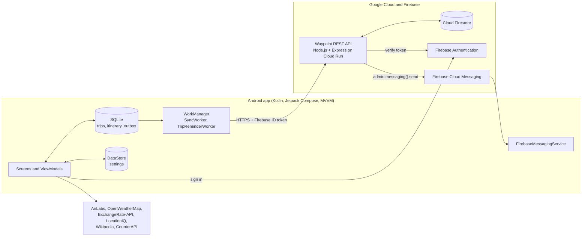

| Layer | Technology |
|---|---|
| Language | Kotlin |
| UI | Jetpack Compose, Material 3, custom Waypoint theme (light and dark) |
| Pattern | MVVM (ViewModel + StateFlow), repositories for all data access |
| Local storage | SQLite (`SQLiteOpenHelper`) for trips, itinerary and the sync outbox; Jetpack DataStore for settings |
| Background work | WorkManager (sync and reminders) |
| Networking | One shared OkHttp client: 30 s read timeout, signs the user out on a 401 from our API |
| Backend | Node.js + Express REST API on Google Cloud Run (`africa-south1`), Cloud Firestore |
| Authentication | Firebase Authentication (Google via Credential Manager, GitHub, email and password) + BiometricPrompt |
| Push | Firebase Cloud Messaging, sent by the API with the Admin SDK |
| Build | Gradle (Kotlin DSL), min SDK 26, target SDK 36, R8 for release builds |

Third-party API keys are not stored in the app. It fetches them at runtime from `GET /config/keys` (authenticated) and caches them, so a fresh clone needs no key file. The server's keys and Firebase service account live in Cloud Run environment variables and Secret Manager, never in Git.

---

## Design considerations

The main structural choices, and why we made them.

**Offline-first, with the phone as the working copy.** Travellers often have poor signal or expensive roaming, exactly when they need their itinerary. So screens read from SQLite on the phone, every change is saved there first, and an outbox syncs it to the API in the background. The trade-off is conflict handling. We chose "most recent `updatedAt` wins" because trips are personal and rarely edited on two phones at once, and we never let the cloud overwrite a change that hasn't been uploaded yet.

**A custom REST API between the app and Firestore.** The app never talks to Firestore directly. Going through our own API means ownership is checked in one place on the server (the user id comes from the verified Firebase token), input is validated before anything is stored, pushes can be sent when something happens, and the database could change without updating the app.

**Hosting close to our users.** The API runs on Google Cloud Run in `africa-south1` (Johannesburg) for low latency in South Africa. Cloud Run scales to zero when idle, which keeps it free, but the first request after a quiet spell is slow. The app allows for this by calling `/health` when it starts and allowing 30 seconds for responses.

**No secrets in the app or the repository.** Third-party API keys are served by the API to signed-in users and cached on the phone, so they can be changed without a new app release and are never committed. Server credentials are in Cloud Run and Secret Manager.

**Staying inside free API quotas.** AirLabs and LocationIQ have small free quotas shared by every user. A usage guardian counts calls per day and month and falls back to cached results when the budget runs out, and weather, currency and places are cached on the phone and in a shared API cache.

**MVVM with repositories.** Each screen has a ViewModel exposing a `StateFlow` of UI state; repositories own all database and network access. This keeps screens simple, and lets us unit-test the logic (validation, sync rules, currency maths, reminder timing) without a device.

**Background work through WorkManager.** Sync and reminders run as WorkManager jobs, so they survive the app being closed or the phone restarting, respect network constraints, and retry with backoff.

**Biometrics on top of sign-in, not instead of it.** The fingerprint or face prompt only unlocks an existing Firebase session; no password is stored on the phone. It accepts the phone's PIN as a fallback, so users without biometrics enrolled are never locked out.

**A consistent visual identity.** Waypoint has its own warm terracotta-and-cream palette, the Rubik typeface, shared spacing and corner-radius tokens, and matching light and dark themes. All colours live in the theme, never in individual screens. Buttons have at least a 40 dp tap area and icons have content descriptions for screen readers.

**Logging.** 30 classes log with their own tag (`MainActivity`, `SyncWorker`, `SettingsSync`, `WaypointFCM`, `TripReminderWorker`, `WaypointApiRepo` and others), so Logcat shows the app's lifecycle (start, foreground, background, notification opens) and its state changes: each sync run, settings uploads and downloads, pushes received, reminders sent, API status codes and failures. The API logs every request with its status and response time in the Cloud Run logs.

---

## REST API

**Base URL:** `https://prog7314-git-287180570190.africa-south1.run.app`
**Interactive docs:** [Swagger UI](https://prog7314-git-287180570190.africa-south1.run.app/docs) ([raw OpenAPI spec](https://prog7314-git-287180570190.africa-south1.run.app/openapi.json))

Every route except `GET /health` and `GET /config/web-client-id` requires a Firebase ID token as `Authorization: Bearer <token>`. The API takes the user id from the verified token, never from the request, and every query is filtered by it, so one user can never read or change another user's data. Errors use clear status codes: `400` with a message for invalid input, `401` for a missing or invalid token, `403` when the record belongs to someone else, and `404` when it does not exist.

| Method | Endpoint | Purpose |
|---|---|---|
| GET | `/health` | Liveness check, called when the app starts to wake the server |
| GET, POST | `/trips` | List the user's trips, create a trip (sends a push to the user's other devices) |
| GET, PUT, DELETE | `/trips/{id}` | Read, update or delete a trip (delete cascades to its itinerary) |
| GET | `/itinerary/days/{tripId}`, `/itinerary/flights/{dayId}`, `/itinerary/lodging/{tripId}`, `/itinerary/cars/{tripId}`, `/itinerary/places/{dayId}` | List itinerary items |
| POST | `/itinerary/days`, `/flights`, `/lodging`, `/cars`, `/places` | Create an itinerary item |
| PUT, DELETE | `/itinerary/{days,flights,lodging,cars,places}/{id}` | Update or delete an itinerary item |
| GET | `/config/keys` | Third-party API keys for the app |
| GET | `/config/web-client-id` | Google sign-in client id (public, needed before sign-in) |
| GET, PUT | `/cache/{path}` | Shared weather, currency and places cache |
| POST, DELETE | `/devices`, `/devices/{token}` | Register or remove a phone's FCM token |
| GET, PUT | `/account/settings` | The user's synced settings |
| DELETE | `/account` | Delete all of the user's cloud data |
| POST | `/notify/test` | Send a test push to the caller's devices (for demos from Swagger or Postman) |

All 36 operations are documented, and can be called live, in the Swagger UI. Creates use a UUID made on the phone, so a retried request never creates a duplicate.

### Deployment

The API in [`api/`](api/) is containerised ([`api/Dockerfile`](api/Dockerfile), Node 20, production dependencies only) and deployed to Cloud Run:

```bash
gcloud run deploy prog7314-git --source api --region africa-south1
```

| Setting | Value |
|---|---|
| Service | `prog7314-git` |
| Region | `africa-south1` (Johannesburg, lowest latency for South African users) |
| Resources | 1 vCPU, 512 MiB, scales from 0 to 20 instances |
| Credentials | Secret Manager secret `firebase-secret`, injected as `FIREBASE_SERVICE_ACCOUNT` |

Deploys are run by hand rather than from GitHub Actions, which keeps a deliberate step between merging code and changing the live service. Cloud Run keeps earlier revisions, so a bad deploy is rolled back by moving traffic back to the previous revision.

---

## Offline mode and sync

The app is offline-first for trips and the whole itinerary:

1. Screens read from SQLite, so they behave the same with or without signal.
2. Every create, edit and delete is written to SQLite straight away and added to a **sync outbox** table. Several edits to the same item are merged into one pending change, and a create followed by a delete before syncing sends nothing.
3. Saving schedules `SyncWorker` through WorkManager with a network-connected constraint, so offline changes wait until the phone reconnects. A 15-minute periodic sync is the backup. Failed uploads retry with exponential backoff.
4. The worker uploads the outbox (trips first, then days, then their items), then downloads anything changed on other devices.
5. **Conflicts:** the most recent `updatedAt` wins. A local change that has not been uploaded yet is never overwritten by the cloud copy.

The user can see what is happening: a header icon shows when the phone is offline, trips with unsynced changes show a small cloud icon, and Settings shows the last sync time with a **Sync now** button.

---

## Notifications

- `WaypointMessagingService` receives FCM messages and sends the device token to the API after sign-in and whenever it changes. It is removed from the API on sign-out.
- **Real events:** when a trip is created, the API sends a push to the user's other devices with `admin.messaging()`, skipping the device that made the change, and removes tokens FCM reports as invalid. It checks the user's Trip updates setting first.
- **Reminders:** the smart reminders (feature 4) are scheduled on the phone.
- There are two notification channels, Trip updates and Trip reminders, with matching switches in Settings. On Android 13 and later the app asks for permission and explains why.
- The push carries only data, and the phone builds the text from its own strings, so notifications appear in the user's language. Tapping a notification opens the trip it is about.

---

## Languages

Waypoint is fully translated into **English**, **isiZulu** and **isiXhosa**. All text is in `strings.xml` (`values`, `values-zu`, `values-xh`), using placeholders and plurals so word order and counts read correctly in each language. A unit test (`TranslationParityTest`) fails the build if any key is missing from a language, and lint reports no hard-coded text.

The language picker in Settings uses `AppCompatDelegate.setApplicationLocales()`. `locales_config.xml` is registered in the manifest, so Android 13 and later also list the three languages in the phone's own app-language settings. Text that comes from third-party services (Wikipedia summaries, weather descriptions) is shown in the language those services return.

---

## Security

- No API keys, passwords or keystores are committed. `.gitignore` excludes `apikey.properties`, `keystore.properties`, `*.jks`, `*.keystore`, `local.properties` and `.env`. The release signing key is kept as encrypted GitHub repository secrets, never in the repository.
- `google-services.json` is committed, as Firebase recommends. It identifies the project and holds no secrets.
- Every API route checks the Firebase ID token and filters data by the user id taken from it.
- No password is ever stored on the phone. Biometric unlock only gates an existing Firebase session.

---

## Screenshots

*(Captured on a physical Android device)*

| Welcome | Home | Itinerary | Explore |
|---|---|---|---|
| 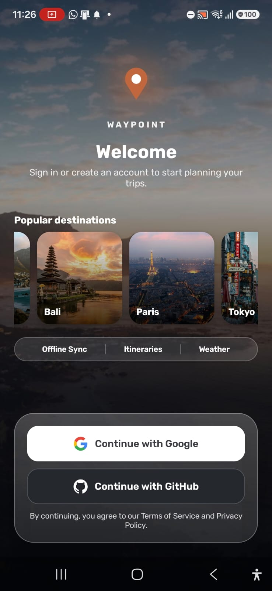 | 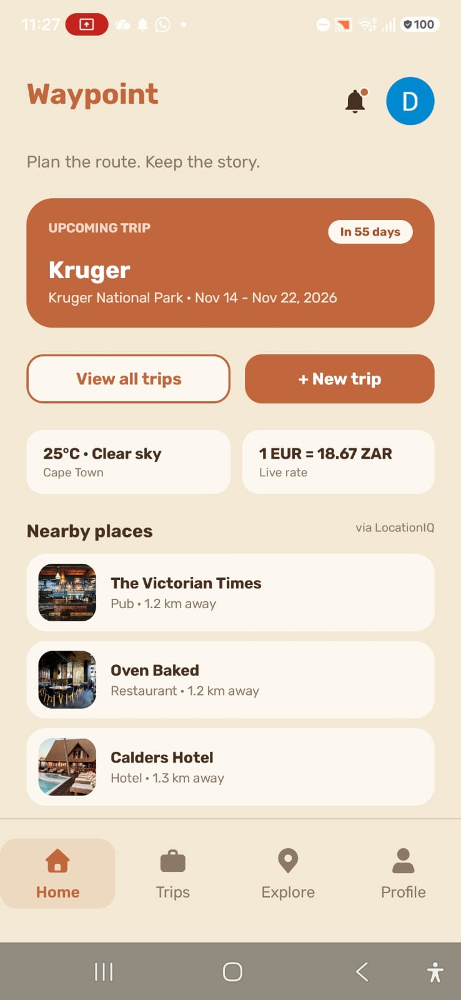 | 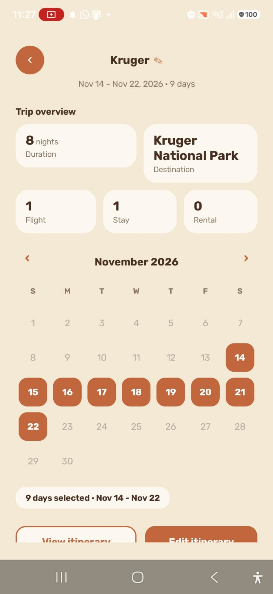 | 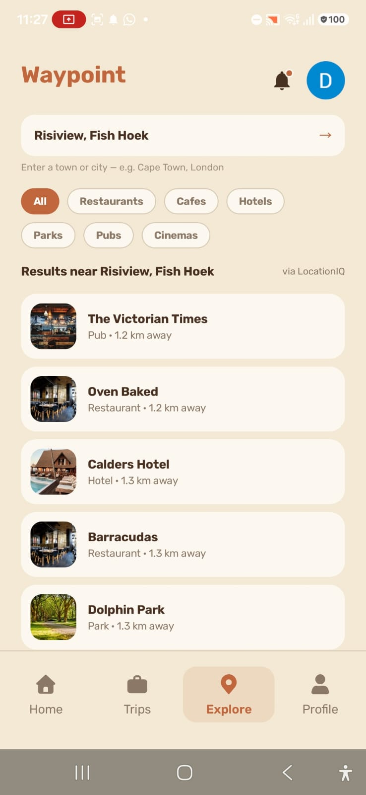 |

| Live flight status | Currency converter |
|---|---|
| 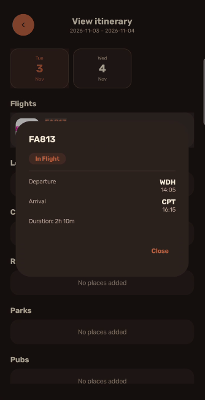 | 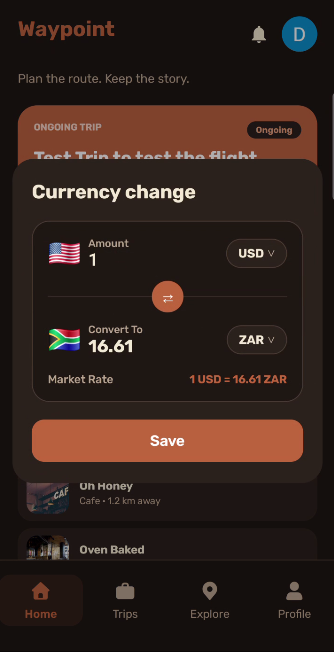 |

### Dark mode

| Home | Itinerary | Profile |
|---|---|---|
|  |  | 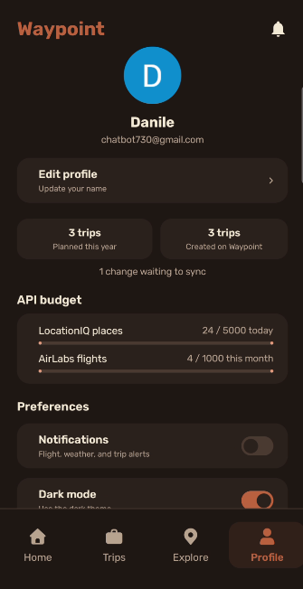 |

---

## Cloud data verification

### Firebase Authentication

Users who sign in appear in the Firebase Authentication user table. Each user's UID is the `accountId` stored on every trip, which is how the API scopes data to its owner.

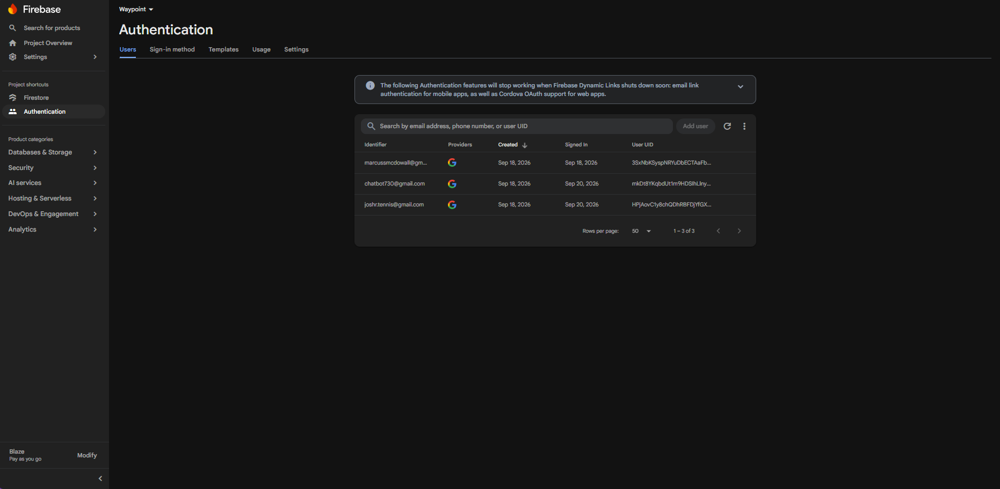

### Firestore: trips

Trips created in the app are written to Firestore through the REST API. The `accountId` field matches the signed-in user's Firebase UID.

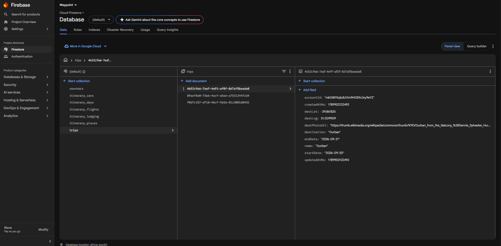

### Firestore: itinerary

Itinerary items live in their own collections, linked by `tripId` and `dayId`: `itinerary_days`, `itinerary_flights`, `itinerary_lodging`, `itinerary_cars` and `itinerary_places`. Each route checks the parent trip's `accountId` before any read or write. The app syncs all of them through the outbox.

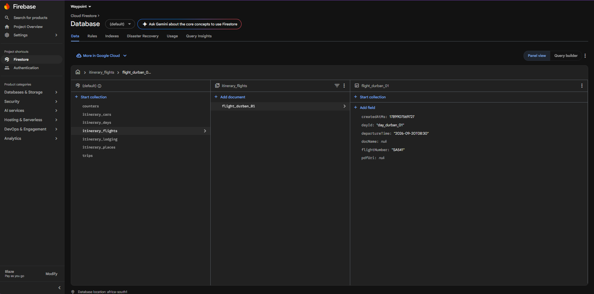

---

## Version control

The project has been in Git and on GitHub from the first commit (24 July 2026), with no zip files or manual uploads. At the final submission `dev` holds **433 commits** (plus merge commits) from all four team members, each committing from their own GitHub account.

**Branches.**
- `main` holds what we release. Every push to `main` runs the release pipeline.
- `dev` is the integration branch, where finished work is merged and tested together.
- **Short-lived branches** carry each piece of work, named by type: `feat/` for features (e.g. `feat/dark-theme`, `feat/api-usage-guardian`, `feat/udf-reminders-flights`), `fix/` for bug fixes (`fix/biometric-polish`, `fix/part3-app-code`), `test/` for tests, `docs/` for documentation and `chore/` for build and CI work (`chore/release-workflow`).

**Pull requests.** Branches are merged into `dev` through pull requests, 72 so far. Opening a PR runs the full CI pipeline (lint, unit tests, API tests, debug and release builds), and a teammate reviews the change before it is merged. `dev` is merged into `main` the same way for a release, so `main` always builds.

**Commit messages.** We use the Conventional Commits style, `type(scope): summary`, with a body explaining why when it isn't obvious. Of the 433 commits: 200 `feat`, 107 `fix`, 33 `docs`, 22 `test`, 21 `refactor`, 16 `chore`, 9 `build`, 8 `style` and 8 `ci`. Examples:

```
feat(sync): add SyncWorker with network constraint and backoff
fix(sync): schedule outbox sync on mutation and pull remote updates
test(api): add 14 Jest tests for /account/settings and push gating
```

**What Git keeps out.** `.gitignore` excludes build output, `.gradle/`, `.idea/`, `local.properties`, keystores, `apikey.properties`, `keystore.properties` and `.env` files. `.gitattributes` forces LF line endings, so `gradlew` runs on the Linux CI runners.

**Tags and releases.** The Part 2 submission is tagged `part-2`, and the final submission is tagged `v1.0.0-final-poe`, with a GitHub Release carrying the signed APK, the AAB and the release notes.

---

## CI/CD and automated testing

### Android CI ([`android-ci.yml`](.github/workflows/android-ci.yml))

Every push and pull request to `main` or `dev` runs five jobs on `ubuntu-latest` with JDK 17 and Node 20:

1. **Lint**: `./gradlew lintDebug`, with the HTML report uploaded
2. **Unit tests**: `./gradlew testDebugUnitTest`, with results published as a check on the PR
3. **Build**: `./gradlew assembleDebug`, with the debug APK uploaded
4. **API tests**: `npm test` in `api/`
5. **Release build**: `./gradlew assembleRelease` with R8, which catches anything minification would break

A Discord webhook posts each job's result to the team.

### Tests

**150 Android unit tests** in 23 classes (`app/src/test`) and **58 API tests** in 7 files (`api/test`, Jest + Supertest with an in-memory Firestore mock).

| Android test class | What it covers |
|---|---|
| `TripValidationTest` | Trip names, date order, flight number format |
| `CurrencyConversionTest`, `AmountInputTest` | Conversion and rounding across currency pairs, amount input parsing |
| `AirLabsDateTest` | Flight lookup by travel date |
| `OutboxCoalescingTest`, `SyncFailureRulesTest`, `TripMergeTest` | Offline sync: merging pending changes, which failures retry, last-write-wins merging |
| `SettingsSyncRulesTest` | Settings conflict rule, defaults, when a 401 ends the session |
| `ReminderAndItineraryEditRulesTest` | When reminders run, booking date ranges, place notes |
| `EmailAuthValidatorTest`, `BiometricErrorsTest`, `ProfileTest` | Sign-in validation, biometric error messages, profile rules |
| `UsageGuardianTest` | API budget counting and fallback |
| `PlacesCacheOrderTest`, `PlacesCacheSerializerTest`, `CacheModelsTest`, `GitHubCacheRepositoryPathTest`, `WeatherRepositoryTest` | Caching rules and cache keys |
| `TranslationParityTest`, `AppLanguageTest` | Every string exists in all three languages |
| `ExplorePlaceFilterTest`, `TripEntityTest`, `ItineraryEntitiesTest` | Explore filters and data models |

| API test file | What it covers |
|---|---|
| `trips.test.js`, `itinerary.test.js` | CRUD, validation (400), ownership (403), not found (404), cascade delete |
| `settings.test.js` | Settings defaults, per-user isolation, last write wins, validation, push opt-out |
| `auth.test.js`, `notify.test.js`, `account.test.js`, `setup.test.js` | Token checks, push sending and invalid-token pruning, account deletion |

Run them locally:

```bash
./gradlew testDebugUnitTest
```

```bash
cd api && npm test
```

### Release pipeline ([`release.yml`](.github/workflows/release.yml))

The release workflow builds a signed APK (for installing on a phone) and a signed App Bundle (for Google Play) with R8, and checks the APK's signature.

- **Every push to `main`** builds both files as a workflow artifact, so each merge proves the release build still works.
- **Pushing a version tag** (e.g. `v1.0.0-final-poe`) also creates the GitHub Release for that tag, with the APK, the AAB, the R8 mapping file and [`docs/release-notes.md`](docs/release-notes.md) as its description.

Builds are signed with our upload key, which is stored as encrypted GitHub repository secrets (`RELEASE_KEYSTORE_BASE64`, `RELEASE_STORE_PASSWORD`, `RELEASE_KEY_ALIAS`, `RELEASE_KEY_PASSWORD`) and only written to the build machine for the length of the job. It is never committed. If the secrets are missing (for example on a fork), the build is left unsigned and no release is published.

---

## Play Store preparation

Everything for the Play listing is in the [`store-listing`](store-listing/README.md) folder:

- **Listing text** ([listing.md](store-listing/listing.md)): app name, short and full description within Google's character limits, category, contact details and "What's new" text
- **Graphics**: a [512 × 512 icon](store-listing/graphics/icon-512.png), a [1024 × 500 feature graphic](store-listing/graphics/feature-graphic.png) and [phone screenshots](store-listing/screenshots) of real screens
- **Policies**: [privacy policy](store-listing/privacy-policy.md) (published at <https://st10438409-emeris.github.io/waypoint-privacy/>), [Data safety answers](store-listing/data-safety.md) and the [content rating questionnaire](store-listing/content-rating.md) (Everyone / PEGI 3)
- **Signed build**: application id `com.waypoint.app`, version `1.0.0` (code 1), R8 on. The release AAB and APK are signed with our own upload keystore, kept outside the repository (`keystore.properties.example` shows the fields), and attached to the GitHub Release.
- **Launcher icon**: an adaptive icon built from the Waypoint pin, with a monochrome layer for Android 13 themed icons

| | |
|---|---|
|  |  |

| Signing key | Release variant | Build successful | Signed APK |
|---|---|---|---|
| 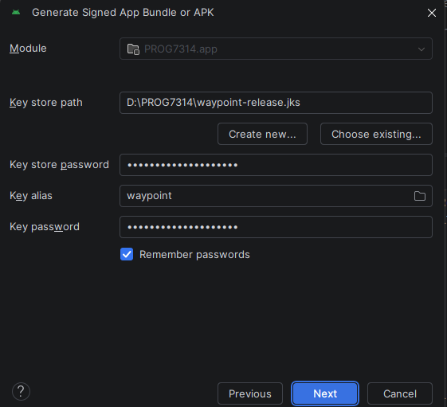 | 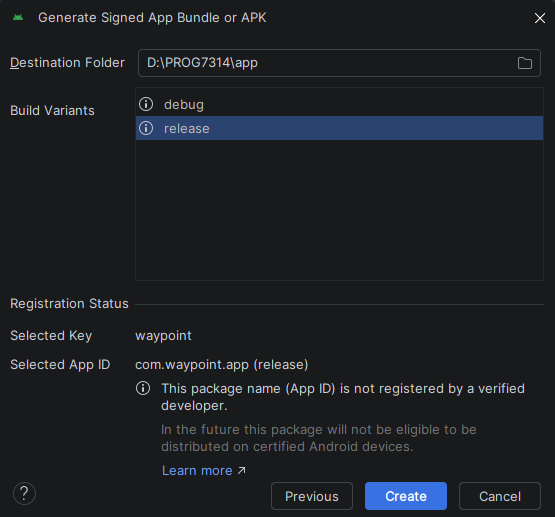 | 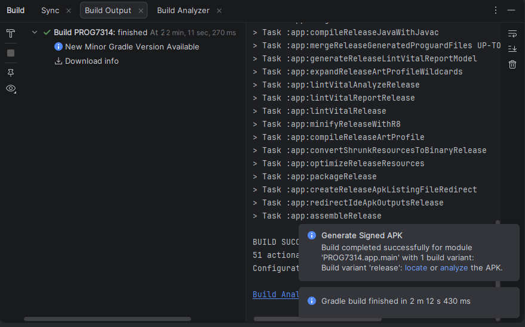 | 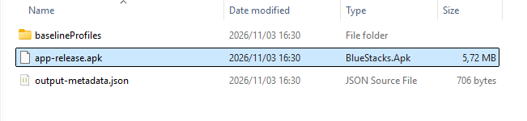 |

---

## Release notes

The release notes for the final version, listing everything new, improved and fixed since the Part 2 prototype and which of our user-defined features were added, are in [`docs/release-notes.md`](docs/release-notes.md). The same notes are published with the signed APK and AAB on the [GitHub Release](https://github.com/JoshRobertsZA/PROG7314/releases).

---

## Running the project

### Android app

1. Clone the repository:
   ```bash
   git clone https://github.com/JoshRobertsZA/PROG7314.git
   ```
2. Open the project in Android Studio (latest stable version) and let Gradle sync. It uses JDK 17.
3. Connect an Android phone (Android 8.0 / API 26 or later) with USB debugging on, and press **Run**.

`google-services.json` is already in `app/`, and the third-party API keys are fetched from the hosted API after sign-in, so no extra files are needed. To use your own key for a service instead of the shared one, copy `apikey.properties.example` to `apikey.properties` and fill it in.

To build a signed release, copy `keystore.properties.example` to `keystore.properties`, point it at your keystore, and run `./gradlew bundleRelease assembleRelease`.

### REST API (optional, the app uses the hosted API)

```bash
cd api
cp .env.example .env
npm install
npm run dev
```

Fill `.env` with a Firebase service account and the API keys listed in [`api/.env.example`](api/.env.example). The API starts on port 8080, with Swagger UI at `/docs`.

---

## Team contributions

| Member | Main contributions |
|---|---|
| **Dylan Shortt** (ST10438409) | Explore nearby, Home (weather, currency), trip calendar and itinerary screens, AirLabs flight lookups and the API usage guardian, trips list, notifications and reminders, store listing, signed release builds and the release pipeline |
| **Marcus McDowall** (ST10356369) | REST API (routes, validation, push, settings), offline sync (outbox, SyncWorker, merging), Compose navigation, auth flows, profile and account deletion, API tests in CI |
| **Joshua Roberts** (ST10265742) | UI and theming, sign-in and biometrics, splash screen, API work, settings, i18n, itinerary editing, the parallel CI workflow, and the README |
| **Grace Berrill** (ST10440118) | isiZulu and isiXhosa translations, accessibility, input validation, offline indicator, welcome screen and UI polish |

Everyone committed from their own GitHub account, and work was merged into `dev` and `main` through pull requests.

---

## AI usage

Our AI usage write-up is in [docs/ai-writeup.md](docs/ai-writeup.md). It covers which AI tools we used (Claude Code and Gemini in Android Studio), what we used them for, how every AI-assisted change was checked before being committed, and how the tools are cited.

---

## References

AirLabs (n.d.) *AirLabs Flight API documentation*. Available at: https://airlabs.co/docs (Accessed: 19 September 2026).

Android Developers (2024) *Guide to app architecture*. Available at: https://developer.android.com/topic/architecture (Accessed: 1 September 2026).

Android Developers (2024) *Jetpack Compose documentation*. Available at: https://developer.android.com/jetpack/compose/documentation (Accessed: 2 September 2026).

Android Developers (2024) *SQLiteOpenHelper*. Available at: https://developer.android.com/reference/android/database/sqlite/SQLiteOpenHelper (Accessed: 16 September 2026).

Android Developers (2024) *Schedule tasks with WorkManager*. Available at: https://developer.android.com/topic/libraries/architecture/workmanager (Accessed: 18 September 2026).

Android Developers (2024) *Show a biometric authentication dialog*. Available at: https://developer.android.com/training/sign-in/biometric-auth (Accessed: 18 September 2026).

Android Developers (2024) *Sign in your user with Credential Manager*. Available at: https://developer.android.com/identity/sign-in/credential-manager (Accessed: 18 September 2026).

Android Developers (2024) *DataStore*. Available at: https://developer.android.com/topic/libraries/architecture/datastore (Accessed: 5 November 2026).

Android Developers (2024) *Per-app language preferences*. Available at: https://developer.android.com/guide/topics/resources/app-languages (Accessed: 5 November 2026).

CounterAPI (n.d.) *CounterAPI documentation*. Available at: https://counterapi.dev/ (Accessed: 17 September 2026).

ExchangeRate-API (n.d.) *ExchangeRate-API documentation*. Available at: https://www.exchangerate-api.com/docs (Accessed: 9 September 2026).

GeeksforGeeks (2023) *Google authentication with Firebase*. Available at: https://www.geeksforgeeks.org/firebase/google-authentication-with-firebase/ (Accessed: 3 September 2026).

GitHub (2024) *GitHub Actions documentation*. Available at: https://docs.github.com/en/actions (Accessed: 18 September 2026).

GitHub (2024) *REST API endpoints for repository contents*. Available at: https://docs.github.com/en/rest/repos/contents (Accessed: 17 September 2026).

Google (2023) *Build an Android app with Firebase and Jetpack Compose* (codelab). Available at: https://firebase.google.com/codelabs/build-android-app-with-firebase-compose (Accessed: 5 September 2026).

Google (2024) *Cloud Firestore REST API*. Available at: https://firebase.google.com/docs/firestore/use-rest-api (Accessed: 19 September 2026).

Google (2024) *Cloud Firestore security rules*. Available at: https://firebase.google.com/docs/firestore/security/get-started (Accessed: 19 September 2026).

Google (2024) *Firebase Authentication for Android*. Available at: https://firebase.google.com/docs/auth/android/start (Accessed: 4 September 2026).

Google (2024) *Firebase Cloud Messaging documentation*. Available at: https://firebase.google.com/docs/cloud-messaging (Accessed: 18 September 2026).

Google (2024) *Get started with Cloud Firestore on Android*. Available at: https://firebase.google.com/docs/firestore/quickstart (Accessed: 17 September 2026).

Google Cloud (2024) *Cloud Run documentation*. Available at: https://cloud.google.com/run/docs (Accessed: 19 September 2026).

JUnit Team (2024) *JUnit 4*. Available at: https://junit.org/junit4/ (Accessed: 18 September 2026).

Kotlin (2024) *Coroutines overview*. Available at: https://kotlinlang.org/docs/coroutines-overview.html (Accessed: 17 September 2026).

LocationIQ (n.d.) *LocationIQ API documentation*. Available at: https://locationiq.com/docs (Accessed: 17 September 2026).

Muturia, E. (2023) *Firebase in Jetpack Compose: authentication & adding data to Cloud Firestore*. Medium. Available at: https://medium.com/@emmanuelmuturia/firebase-in-jetpack-compose-authentication-adding-data-to-cloud-firestore-a6a8e5ebee19 (Accessed: 6 September 2026).

OpenWeatherMap (n.d.) *OpenWeatherMap API documentation*. Available at: https://openweathermap.org/api (Accessed: 16 September 2026).

RapidDevelopers (n.d.) *How to use Firebase Auth with Google login*. Available at: https://www.rapidevelopers.com/firebase-tutorial/how-to-use-firebase-auth-with-google-login (Accessed: 7 September 2026).

Square (2024) *OkHttp documentation*. Available at: https://square.github.io/okhttp/ (Accessed: 17 September 2026).

Stackademic (2024) *Sign in with Google: Firebase Auth + Credential Manager in Jetpack Compose*. Available at: https://blog.stackademic.com/sign-in-with-google-firebase-auth-credential-manager-jetpack-compose-6e151a8c6825 (Accessed: 18 September 2026).

Swagger (2024) *OpenAPI Specification*. Available at: https://swagger.io/specification/ (Accessed: 20 September 2026).

Wikimedia Foundation (n.d.) *Wikipedia REST API*. Available at: https://en.wikipedia.org/api/rest_v1/ (Accessed: 17 September 2026).

YouTube (n.d.) *Video tutorial: Firebase Google Sign-In implementation in Android*. Available at: https://www.youtube.com/watch?v=u6lUQ2PmvgE (Accessed: 27 July 2026).

---

IIE Emeris - Cape Town | PROG7314 | 2026
