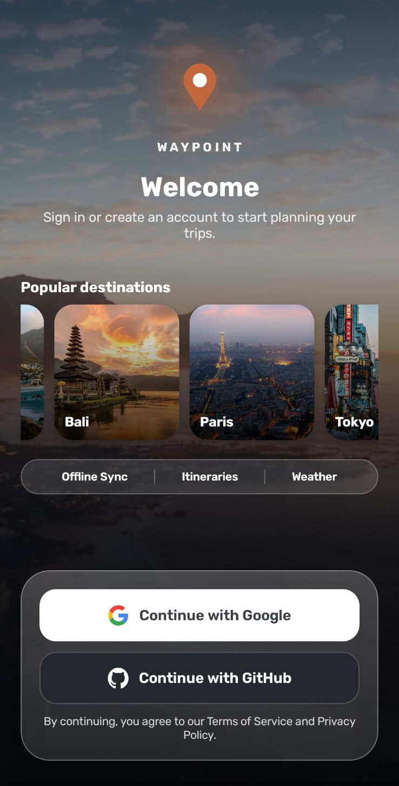
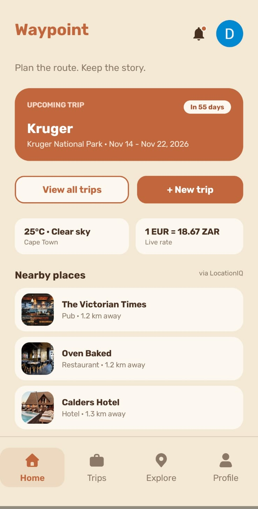
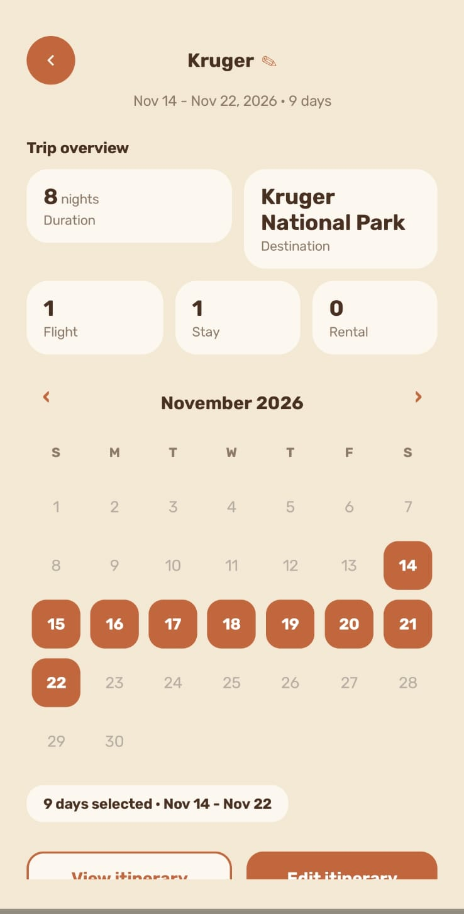
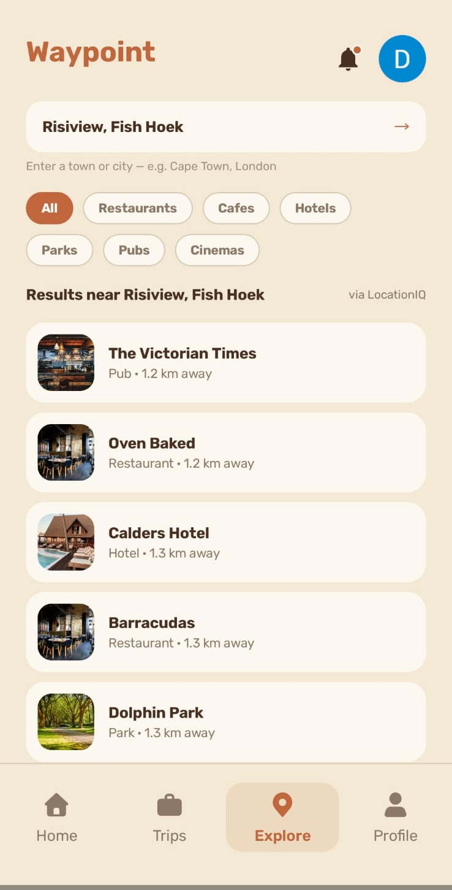
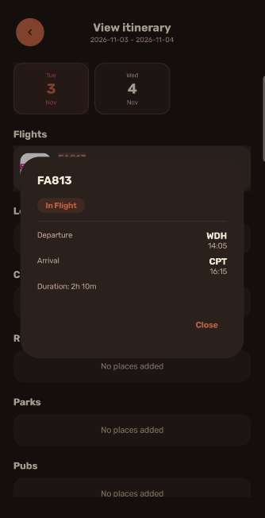
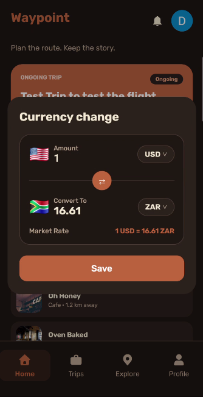
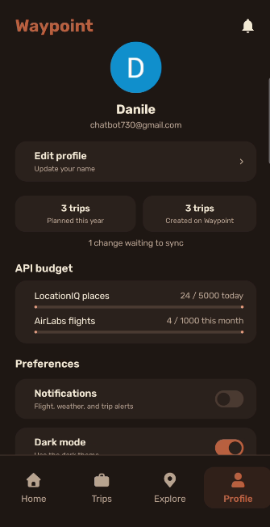

# Store listing

Everything Waypoint needs for a Google Play listing, ready to submit as if we were publishing. We have not paid for a developer account, so nothing has been uploaded to Play.

| File | Play Console page | Contents |
|---|---|---|
| [listing.md](listing.md) | Main store listing | App name, short and full description (within Google's limits), category, tags, contact details, "What's new" text |
| [graphics/icon-512.png](graphics/icon-512.png) | Main store listing | 512 × 512 app icon (32-bit PNG), same artwork as the launcher icon |
| [graphics/feature-graphic.png](graphics/feature-graphic.png) | Main store listing | 1024 × 500 feature graphic |
| [screenshots/](screenshots/) | Main store listing | Phone screenshots of real screens with real data, taken on a physical phone |
| [privacy-policy.md](privacy-policy.md) | App content > Privacy policy | Source text of the policy published at https://st10438409-emeris.github.io/waypoint-privacy/ |
| [data-safety.md](data-safety.md) | App content > Data safety | What data is collected, why, whether it is shared, and the permissions used |
| [content-rating.md](content-rating.md) | App content > Content rating, and the other declarations | IARC questionnaire answers (expected rating: Everyone / PEGI 3), ads, app access, target audience |

## Screenshots

| | | | |
|---|---|---|---|
|  |  |  |  |
|  |  |  | |

## Signed build

| Item | Value |
|---|---|
| Application id | `com.waypoint.app` |
| Version | `1.0.0` (version code 1) |
| Minimum / target SDK | 26 (Android 8.0) / 36 |
| Shrinking | R8 minification and resource shrinking on |
| Signing | Our own upload keystore, kept outside the repository (see `keystore.properties.example`) |
| Files | Signed `.aab` (for Play) and `.apk` (for installing on a phone), attached to the `v1.0.0-final-poe` GitHub Release |

Screenshots of the Android Studio signing wizard are in [assets/release](../assets/release).
